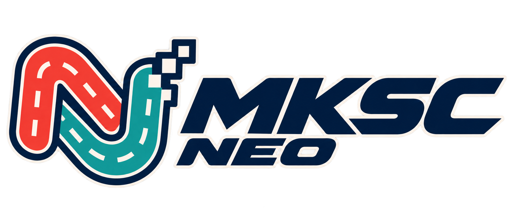

<p align="center">
  
</p>

# MKSC Neo

A native C/SDL3 re-implementation of **Mario Kart: Super Circuit (US)** for
macOS, Linux, Windows, Android and the web, with optional enhancements (any
resolution and aspect ratio, unlocked framerate, local split-screen, modern
menus) and a modding API for custom tracks, karts, items, rules and Lua scripts.

You need your own legally obtained US ROM. No game content is included: on
first start the game asks for your `.gba` file and imports it locally.

## Playing

Play in the browser at <https://arcanite24.github.io/mksc-neo/>, or download
the bundle for your platform from
[Releases](https://github.com/arcanite24/mksc-neo/releases) (macOS, Linux,
Windows, web or Android), start `MKSC Neo.app`, `./mksc`, `mksc.exe` or the APK,
and choose your ROM. To make bundles yourself, see
[docs/BUILDING.md](docs/BUILDING.md).

## Building

Requires CMake 3.20+, a C11 compiler, Python 3 and SDL 3.

```sh
python3 tools/portable/check.py debug         # build and run the headless tests
python3 tools/portable/check.py debug --sdl   # also build the SDL game
.mksc-tools/portable/check/debug-sdl/mksc     # run it
```

## Documentation

Also rendered at <https://arcanite24.github.io/mksc-neo/>.

- [docs/BUILDING.md](docs/BUILDING.md) — build, test, run, controls, releases, Android and web.
- [docs/MODDING.md](docs/MODDING.md) — install and make mods: Lua, data, tracks, 3D courses and models.
- [docs/ARCHITECTURE.md](docs/ARCHITECTURE.md) — how the engine is put together.

## Layout

| Path | Contents |
|---|---|
| `portable/` | The game: deterministic core, app, importer, audio, SDL platform layer and tests. |
| `tools/portable/` | Test runner, reference importer, mod kit and release packaging. |
| `tools/site/` | Project site: home page, rendered docs and the playable web build. |
| `mods/` | Example mods and course hand-pass data. |
| `stores/official/` | Index for the in-game mod store. |

## Credits

MKSC Neo started from the [aplerdal/mksc](https://github.com/aplerdal/mksc)
decompilation of Mario Kart: Super Circuit. The original game's behavior —
physics, collision, AI, items and data formats — was recovered from that work
and re-implemented here as native C. Thanks to its authors and contributors.

Third-party code and fonts are listed in [LICENSE-NOTICE.md](LICENSE-NOTICE.md).

MKSC Neo is not affiliated with or endorsed by Nintendo. Mario Kart is a
trademark of Nintendo.
